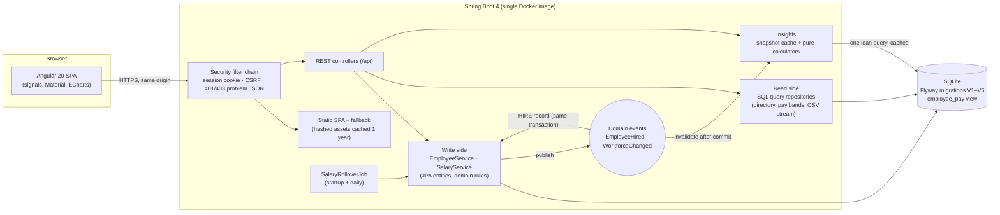
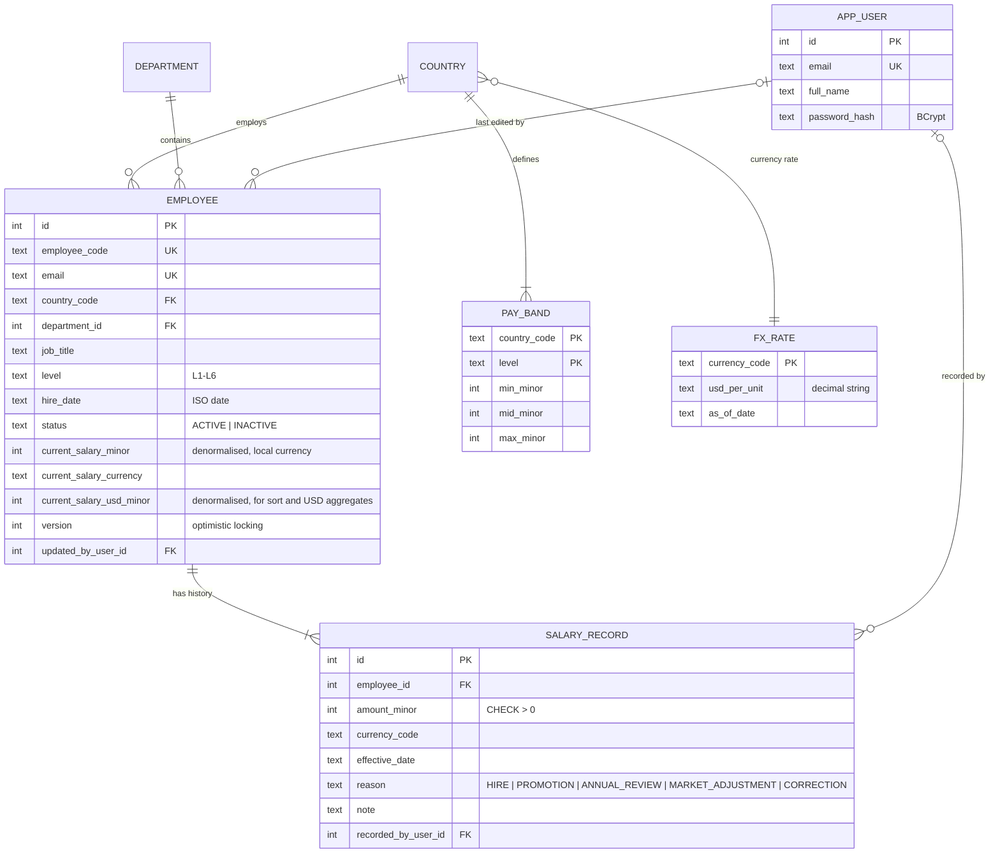
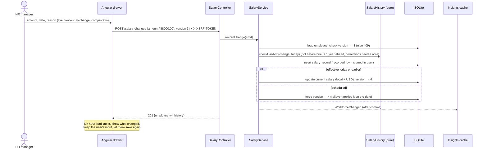
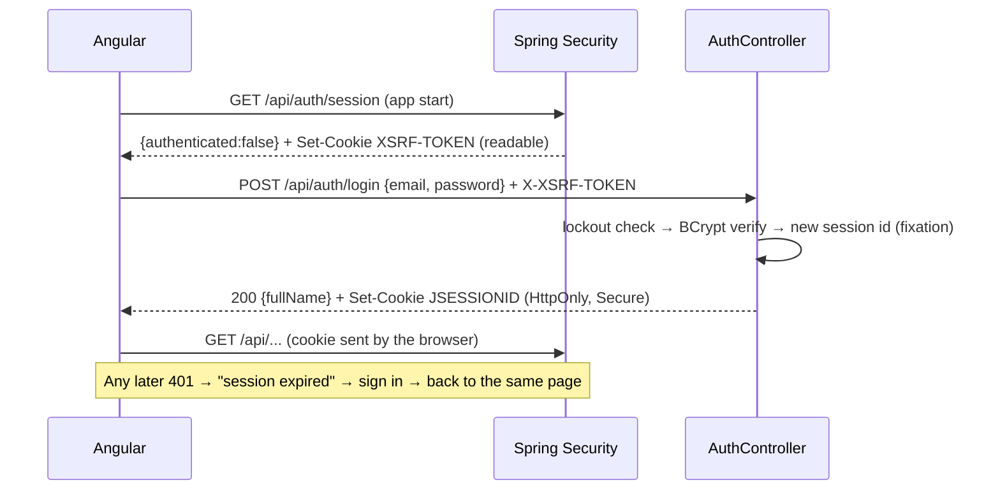

# Design

Pay Atlas is a **modular monolith**: one Spring Boot application that serves a REST API and the Angular single-page
app from the same origin, backed by SQLite. Features are packages with enforced boundaries (ArchUnit), so the
system is simple to run and still easy to split later.

## System overview

**Request path:** every request passes the security filter chain. `/api/**` needs a session; the SPA shell, static
assets, health check and API docs are public. Controllers never touch JPA repositories (an ArchUnit rule): writes go
through services; reads use SQL query repositories that select only the needed columns.

## Packages (by feature)

| Package | Responsibility |
|---|---|
| `employee` | Employee aggregate, create/update/deactivate, directory read model, CSV export |
| `salary` | Effective-dated, append-only salary history; rules in pure `SalaryHistory`; rollover job |
| `payband` | Pay bands per country × level, compa-ratio and band position (SQL view `employee_pay`) |
| `insights` | Workforce snapshot cache, `PayStatistics`, `Histogram`, `InsightsCalculator`, `OutlierDetector` |
| `reference` | Countries, departments, levels, fixed FX rates, `CurrencyConverter` |
| `auth` | Users, session login, lockout, `CurrentUser` for audit, security configuration |
| `meta` | Composes reference data for the UI's filters (sits above the features it reads) |
| `seed` | Deterministic 10k-employee generator and JDBC batch seeder |
| `common` | `Money`, problem-detail errors, CSV writer, SPA serving, OpenAPI |

Each feature has an `api` sub-package for HTTP. Enforced rules (`ArchitectureTest`): no cycles between features,
domain classes free of Spring/JPA, no entities or repositories in `api`, nothing depends on `api`, no `double`/`float`
fields outside seed data.

## Data model

- **Money** is always integer minor units plus an ISO currency (JPY has 0 decimals). Never floating point.
- **Dates** are ISO text, so they sort and compare correctly in SQLite.
- `employee_pay` (view) computes **compa-ratio** in basis points and **band position** once, for search, sort,
  filters and insights alike.
- `current_salary_minor` / `current_salary_usd_minor` duplicate the latest effective salary record. They are a cache,
  kept in sync in the same transaction as every salary change and by the rollover job for scheduled changes.

## Key flows

### Recording a salary change

### Signing in

## API

Interactive documentation: `/swagger-ui.html` (spec at `/v3/api-docs`).

| Area | Endpoints |
|---|---|
| Auth | `GET /api/auth/session`, `POST /api/auth/login`, `POST /api/auth/logout` |
| Employees | `GET /api/employees` (search, filters, sort, paging), `GET /api/employees/export.csv`, `GET/POST /api/employees`, `PUT /api/employees/{id}`, `PATCH /api/employees/{id}/status` |
| Salaries | `GET /api/employees/{id}/salary-history`, `POST /api/employees/{id}/salary-changes` |
| Insights | `GET /api/insights/summary`, `/by-country`, `/by-title?country=`, `/distribution`, `/outliers` |
| Reference | `GET /api/meta`, `GET /api/pay-bands` |

Conventions: errors are RFC 7807 problem details (`400` with field errors, `401`, `403`, `404`, `409`, `429`); money
is `{minorUnits, currency, amount}`; writes that change an employee carry the `version` that was read.

## Frontend

- **Feature folders**: `employees` (directory, drawer, forms), `insights` (dashboard, chart options), `auth` (login);
  `core` (API clients, auth, interceptors) and `shared` (money formatting, band bar, charts, dialogs).
- **The URL is the state**: directory filters, sort, page, the open employee and the dashboard's selected country
  live in the URL, so every view can be bookmarked and shared, and Back works.
- **Logic in pure functions** (query mapping, money parsing and formatting, chart options, salary preview), unit
  tested with Vitest; components stay thin.
- **One error policy**: interceptors turn problem details into toasts, except where a form shows them inline and
  for 401, which means "sign in again".
